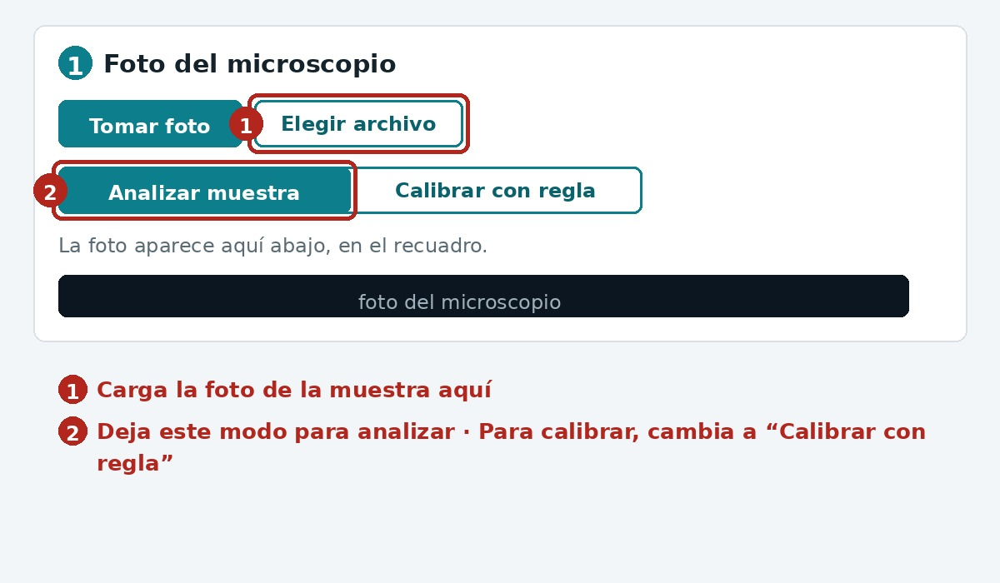
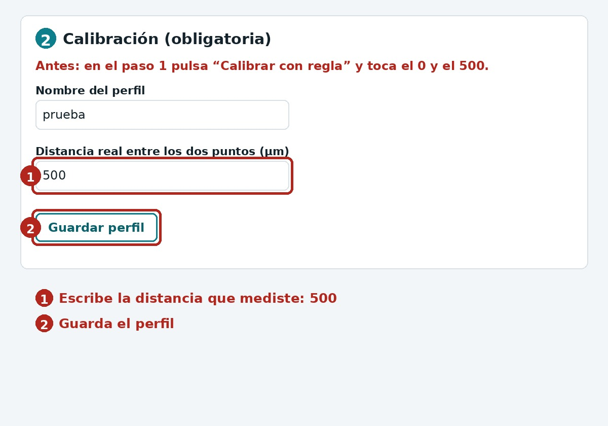
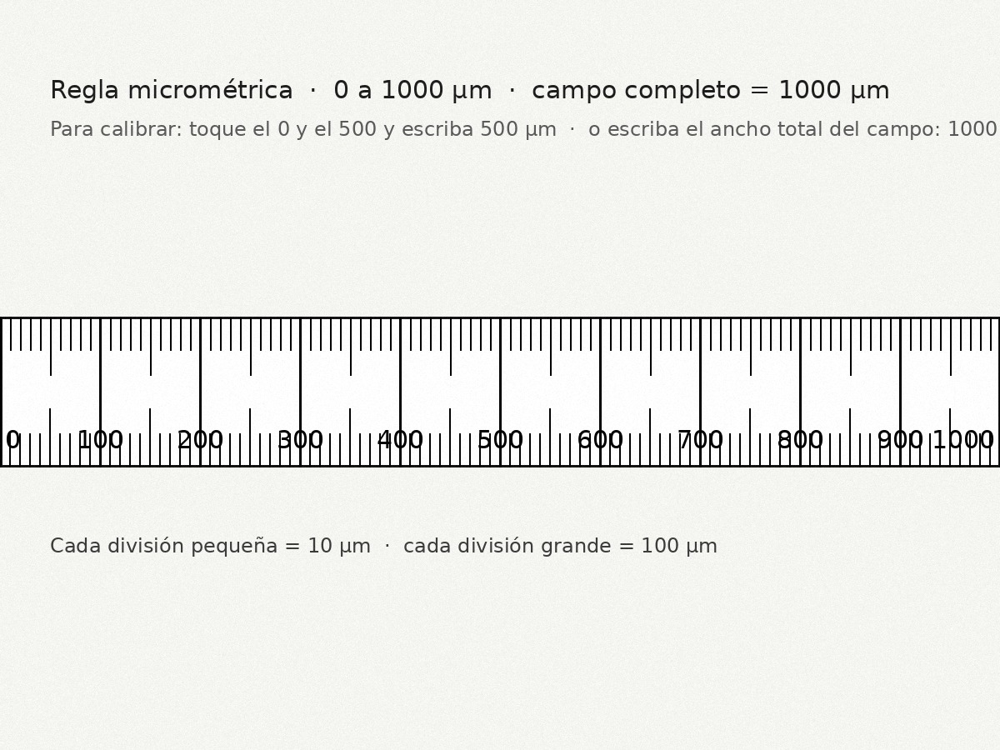
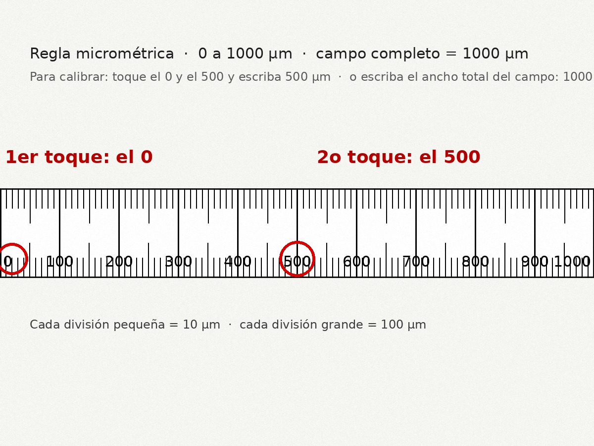
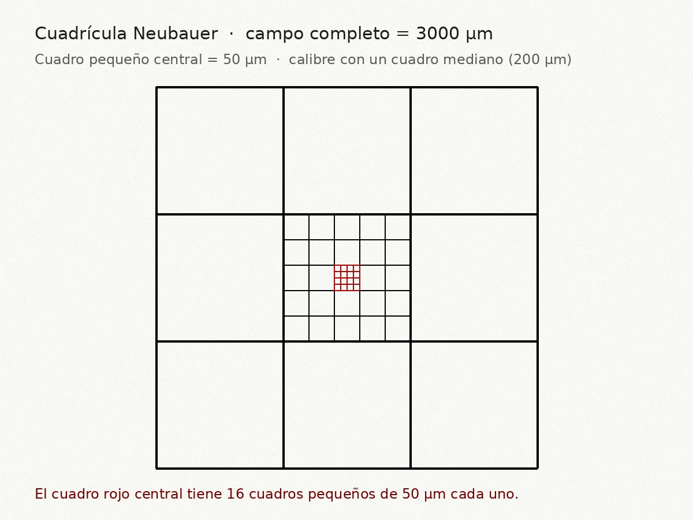
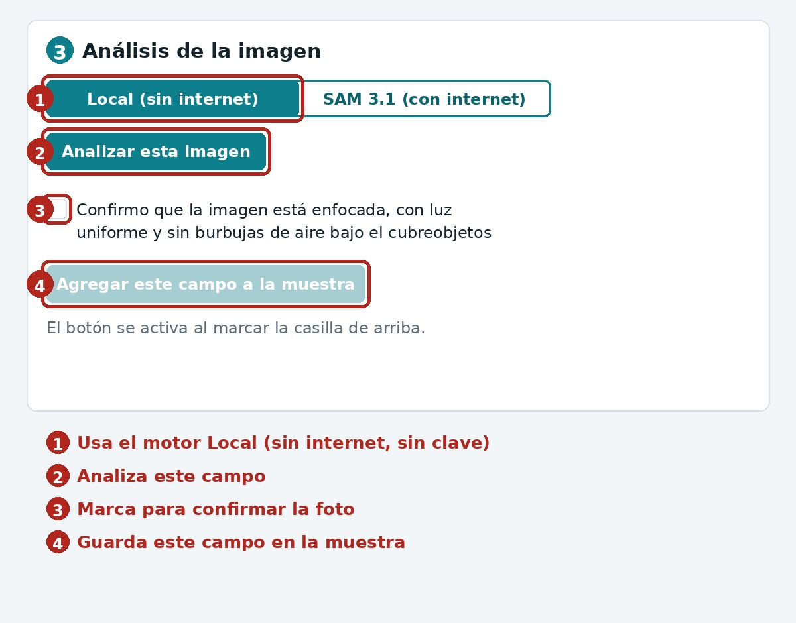
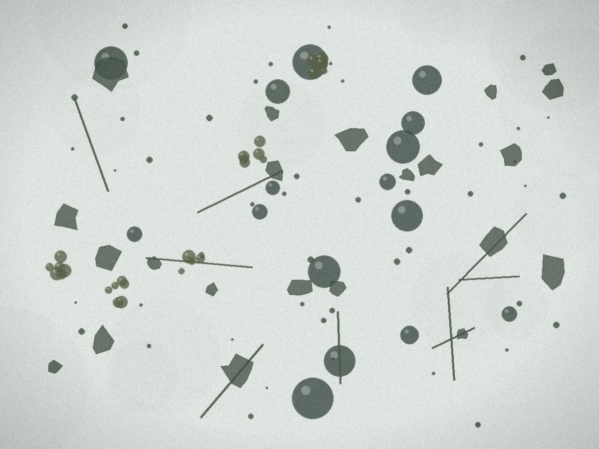
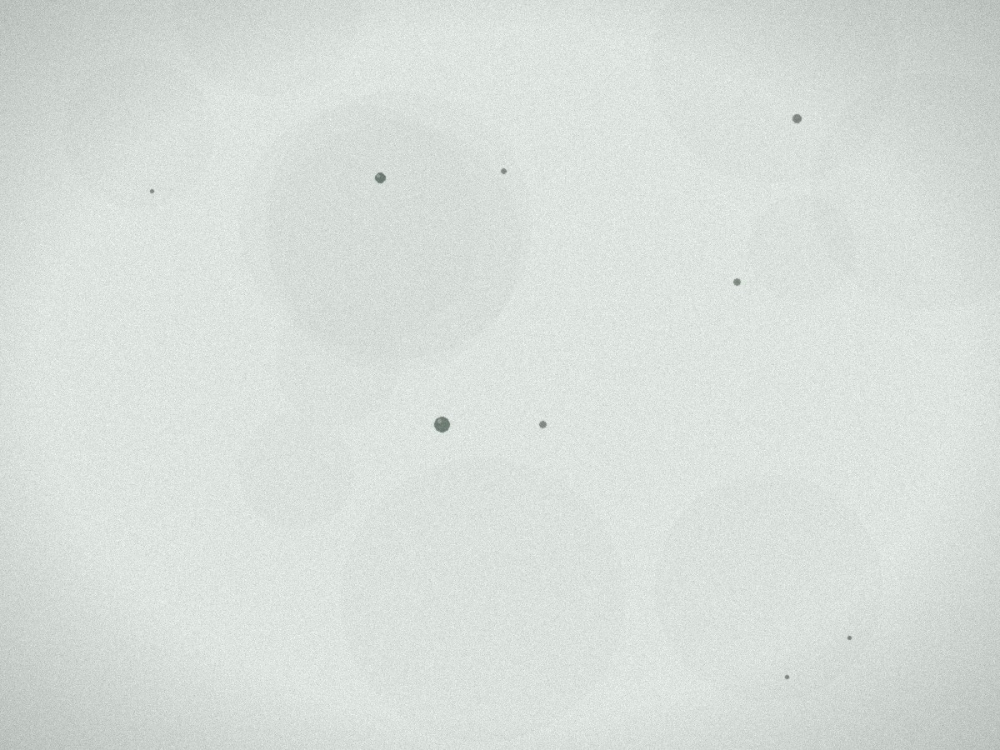
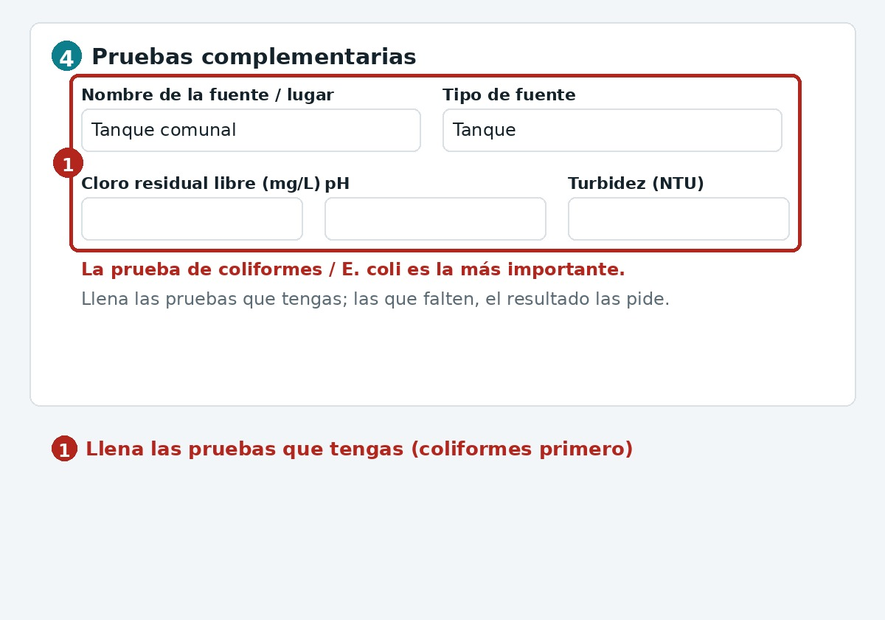
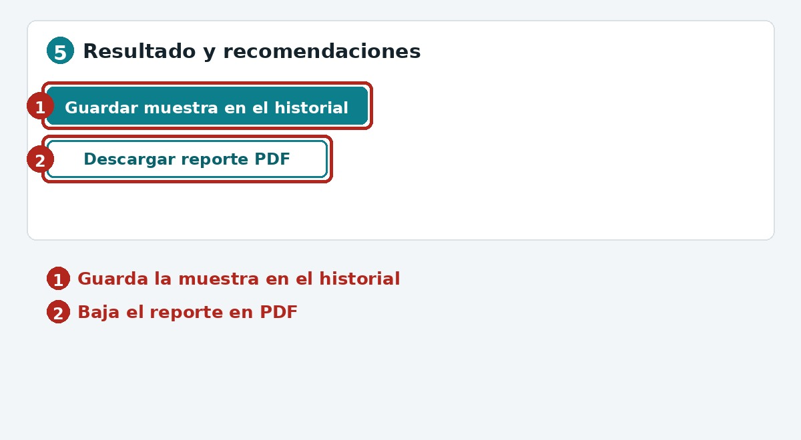

# 📖 Instructivo — Aqua'ja v2.2

**Tamizaje comunitario de agua con microscopio de celular. Uso educativo y de orientación.**

Este instructivo explica, paso a paso y con imágenes, cómo usar Aqua'ja. No necesitas saber de microscopios ni de computación: sigue los pasos en orden.

---

## 💧 Qué es Aqua'ja

Aqua'ja revisa una muestra de agua con el microscopio de un celular. Toma la foto de la muestra, la calibra y la analiza para detectar problemas **visibles** (turbidez, partículas, filamentos) y guarda un historial con validación.

> ⚠️ **Importante:** esta herramienta detecta problemas visibles. **No detecta bacterias, virus ni sustancias químicas.** Un resultado sin hallazgos **no garantiza que el agua sea potable** y no sustituye el análisis de laboratorio. La prueba más importante es la de coliformes / *E. coli*.

---

## ✅ Resumen: el flujo completo en 6 pasos

1. **Calibra** con la foto de la regla o de la cuadrícula (paso 2, solo la primera vez por cada aumento).
2. **Carga la foto de la muestra** en el paso 1 (la foto de la regla ya no hace falta: al cargar otra foto, esta reemplaza a la anterior).
3. Elige el motor **Local** (sin internet) y pulsa **Analizar esta imagen** (paso 3).
4. Pulsa **Agregar este campo a la muestra**. Repite con otros campos: mínimo 3, idealmente 5.
5. Anota las **pruebas complementarias** (paso 4), sobre todo coliformes / *E. coli*.
6. Lee el **resultado**, **guarda la muestra en el historial** y **descarga el reporte PDF** (paso 5).

---

## 🧰 Qué necesitas

- Un **celular con cámara** y un **microscopio de celular** (o un adaptador para acoplar el celular al microscopio).
- Una **regla micrométrica** o una **cuadrícula Neubauer** para calibrar (solo la primera vez por cada aumento).
- Internet **solo** si quieres usar el motor SAM 3.1. El motor Local funciona sin internet.
- Opcional: una **clave de API de Meta** si quieres usar SAM 3.1 (ver paso 3).

---

## 🖼️ Imágenes de práctica

En la carpeta `imagenes/` de este instructivo hay 4 imágenes para practicar **sin microscopio ni micrómetro**. Úsalas para aprender el flujo completo antes de salir a campo:

| Imagen | Para qué sirve |
|---|---|
| `01-regla-micrometrica-1000um.jpg` | Calibrar con regla (paso 2) |
| `02-cuadricula-neubauer.jpg` | Calibrar con cuadrícula Neubauer (paso 2) |
| `03-muestra-con-particulas.jpg` | Analizar una muestra con partículas (paso 3) |
| `04-muestra-limpia.jpg` | Analizar una muestra limpia, para comparar (paso 3) |

> 🖼️ **Leyenda — imágenes de prueba:** las 4 imágenes de práctica fueron **generadas con IA** para probar la app sin microscopio. **No son fotos reales de microscopio.** Las reglas de medición que se ven en ellas (la regla de 0–1000 µm y la cuadrícula Neubauer) son **simuladas, solo para fines didácticos**: sirven para aprender a calibrar y a analizar, pero **no son una referencia de medición real**. Para medir muestras de verdad, calibra siempre con la foto de una regla micrométrica o cuadrícula Neubauer real, tomada con ese mismo aumento.

---

## 1️⃣ Paso 1 — Foto del microscopio

1. Abre Aqua'ja en el navegador del celular (o abre el archivo `index.html`).
2. En el **paso 1, Foto del microscopio**, pulsa **Tomar foto** para usar la cámara, o **Elegir archivo** para subir una foto que ya tengas.
3. La foto debe mostrar un solo campo del microscopio, con buena luz y enfocada.

> 💡 **Para practicar:** elige el archivo `03-muestra-con-particulas.jpg` y sigue los pasos. Más adelante repite con `04-muestra-limpia.jpg` para ver la diferencia.

---

## 2️⃣ Paso 2 — Calibración (obligatoria)

Sin calibración no se pueden medir tamaños ni clasificar partículas. Se hace **una sola vez por cada aumento** (por ejemplo 100x y 250x): cada perfil guarda el ancho real del campo, así no calibras en cada sesión. Usa un perfil distinto si cambias de celular o de soporte.

### Opción A — Calibrar con regla micrométrica

> ⚠️ **Primero pulsa el botón Calibrar con regla.** Si no lo haces, tocar la foto no marca nada: la app solo registra los puntos cuando ese modo está activo (el botón se pone de color).

1. En el paso 1 carga la foto de la regla, tomada con esa misma ampliación.
2. Pulsa el botón **Calibrar con regla** (arriba de la foto). El botón queda marcado de color.
3. Toca **dos puntos sobre la imagen** cuya distancia real conozcas. En la imagen de práctica: primero el **0** (primera marca larga del extremo izquierdo, círculo rojo 1) y luego el **500** (marca larga del centro, círculo rojo 2). Aparece una línea roja entre los dos puntos y abajo dice "Puntos marcados: 2 de 2".
4. Baja al paso 2, abre **Crear o actualizar un perfil (regla micrométrica o cuadrícula Neubauer)**.
5. Escribe el **Nombre del perfil** (por ejemplo `prueba` o `250x`).
6. En **Distancia real entre los dos puntos (µm)** escribe la distancia que mediste. En el ejemplo: **500**.
7. Pulsa **Guardar perfil**. El perfil queda activo y aparece en **Perfil de calibración activo**.

> 💡 **Después de guardar el perfil, la foto de la regla ya no hace falta.** Para analizar, carga la foto de la muestra: al elegir otro archivo, la nueva foto reemplaza a la regla automáticamente. No hay que borrar nada.

### Opción B — Calibrar con cuadrícula Neubauer

1. Carga la foto de la cuadrícula en el paso 1 y pulsa **Calibrar con regla**.
2. Toca las esquinas de un **cuadro mediano** (los cuadros pequeños centrales miden 50 µm; un cuadro mediano mide 200 µm).
3. En el paso 2 escribe el nombre del perfil y en **Distancia real entre los dos puntos (µm)** escribe **200**.
4. Pulsa **Guardar perfil**.

### Opción C — Escribir el ancho total del campo

Si ya conoces el ancho total del campo en micras, no necesitas tocar puntos: en el paso 2 escribe el valor en **O escriba el ancho total del campo (µm)** y pulsa **Guardar perfil con este ancho**.

---

## 3️⃣ Paso 3 — Análisis de la imagen

1. Elige el motor de análisis:
   - **Local (sin internet)** — algoritmo clásico que funciona en el celular, sin internet y sin clave. Es el recomendado para empezar.
   - **SAM 3.1 (con internet)** — detecta los objetos por internet con la inteligencia artificial de Meta. Necesita una **clave de API de Meta** propia, que se escribe en el campo **Clave de API de Meta**. La foto se envía a los servidores de Meta y cada análisis gasta saldo de tu cuenta de API (precio publicado: US$2.50 por cada 1,000 imágenes, por concepto). Usa una clave con límite de gasto y no la compartas. No envíes fotos con personas ni datos privados.
   
   > ⚠️ **Elegir Local o SAM solo cambia el modo** (el botón se marca de color; al elegir SAM aparece el cuadro de la clave de API). Eso **no analiza nada todavía**: para analizar hay que pulsar **Analizar esta imagen**.
   >
   > ❌ **SAM 3.1 no funciona sin clave de API de Meta.** La app no trae ninguna clave guardada (una clave es personal y cuesta dinero, así que no se puede incluir). Si no tienes clave, usa el motor **Local**, que funciona sin clave y sin internet. La clave se consigue en la plataforma de desarrolladores de Meta y se pega en el campo **Clave de API de Meta** que aparece al elegir SAM.
2. Pulsa **Analizar esta imagen**. La app marca las partículas detectadas (puedes activar o desactivar **Mostrar partículas detectadas**).
3. **Marca la casilla "Confirmo que la imagen está enfocada, con luz uniforme y sin burbujas de aire bajo el cubreobjetos".** Sin esta casilla, el botón de abajo queda desactivado (se ve pálido y no responde).
4. Pulsa **Agregar este campo a la muestra**. Este paso es obligatorio: si no lo haces, el campo analizado **no** queda en la muestra y el paso 5 dirá "No hay campos de microscopio agregados (paso 3)".
5. Analiza **varios campos de la misma muestra, mínimo 3, idealmente 5**, para que el resultado sea representativo. Repite los pasos 2–4 con cada campo.

> 💡 **Para practicar:** analiza primero la imagen `03-muestra-con-particulas.jpg` (debería detectar esferas, partículas irregulares, fibras y agregados) y luego la `04-muestra-limpia.jpg` (debería salir casi sin nada). Así ves el contraste entre una muestra con problemas visibles y una limpia.

---

## 4️⃣ Paso 4 — Pruebas complementarias

El microscopio no puede verlo todo. En este paso anota las pruebas que el microscopio no cubre:

- **Coliformes / *E. coli* por kit** — la prueba más importante. Si no la has hecho, el resultado lo indica.
- **Cloro, pH y turbidez**, si los mediste.
- **Guardar mi ubicación** — guarda el lugar donde se tomó la muestra (GPS del celular).

---

## 5️⃣ Paso 5 — Resultado y recomendaciones

1. Lee el **resultado** y las **recomendaciones**. Si falta la calibración o faltan pruebas complementarias, la app lo advierte.

   > ⚠️ Si el resultado dice **"No hay campos de microscopio agregados (paso 3)"**, es porque analizaste la imagen pero no pulsaste **Agregar este campo a la muestra**. Vuelve al paso 3, marca la casilla de confirmación y pulsa ese botón; el resultado se actualiza solo.
2. Pulsa **Guardar muestra en el historial** para guardarla con su fecha, lugar y resultados.
3. Pulsa **Descargar reporte PDF** para bajar el reporte de la muestra (incluye los datos, los resultados y la advertencia de uso educativo).

   > 📄 **Ejemplo de reporte:** [ejemplos/reporte-ejemplo.pdf](ejemplos/reporte-ejemplo.pdf) — así se ve el PDF que descarga la app (muestra de práctica con 1 campo y 83 partículas).

---

## 🗂️ Historial y validación

En **Historial y validación** ves todas las muestras guardadas, con su fecha y su resultado. Desde ahí puedes:

- Descargar el **PDF** de cada muestra.
- **Exportar CSV** o JSON con todas las muestras (para llevarlas a una hoja de cálculo).
- **Borrar** una muestra.

---

## ❓ Problemas frecuentes

- **Hago clic en Local o SAM y no pasa nada.** Asegúrate de usar la versión más reciente de `index.html`. Las versiones anteriores a la corrección del nombre Aqua'ja tenían un error que dejaba sin funcionar todos los botones.
- **Elijo SAM o Local y no se analiza nada.** Elegir el motor solo cambia el modo: para analizar hay que pulsar **Analizar esta imagen** (paso 3).
- **Toco la foto de la regla y no se marca nada.** Primero pulsa **Calibrar con regla** (arriba de la foto). Sin ese modo activo, los toques no se registran.
- **¿Dejo la foto de la regla cargada después de calibrar?** No hace falta: al cargar la foto de la muestra, la nueva foto reemplaza a la regla automáticamente. No hay que borrar nada.
- **SAM 3.1 no funciona.** SAM necesita una clave de API de Meta propia. Sin clave no se puede usar. El motor **Local** funciona sin clave y sin internet.
- **"Sin calibrar: no se pueden medir tamaños".** Primero calibra (paso 2). Sin calibración la app detecta partículas pero no puede decir de qué tamaño son.
- **La foto se ve oscura o borrosa.** Limpia el lente, mejora la luz y vuelve a enfocar. Una foto mala da un análisis malo.
- **Un resultado limpio no significa agua potable.** La app solo ve problemas visibles. Para saber si el agua es potable hace falta el análisis de laboratorio y la prueba de coliformes / *E. coli*.

---

## 📄 Licencia

Creative Commons Attribution-NonCommercial-ShareAlike 4.0 International (CC BY-NC-SA 4.0) — uso no comercial, con atribución al autor y compartiendo derivados bajo la misma licencia. Ver `LICENSE` en la raíz del repositorio.
